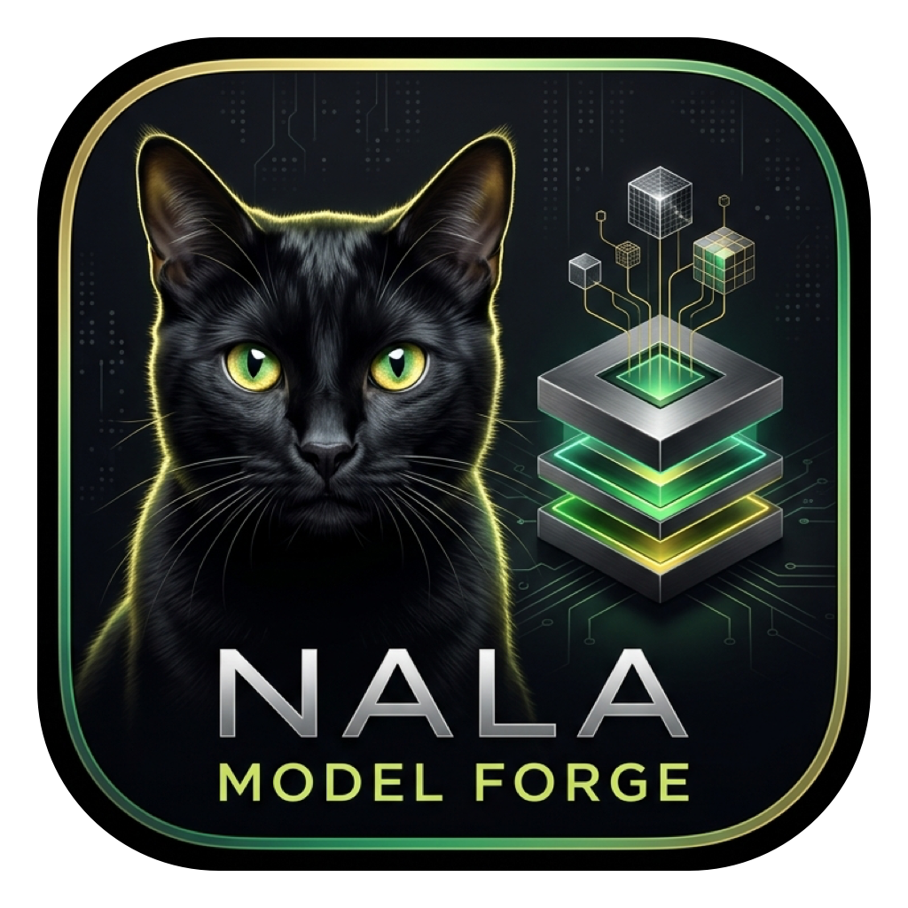

<p align="center">
  
</p>

<h1 align="center">NALA-ModelForge-RS (<code>v1.5.0</code>)</h1>

<p align="center">
  <strong>100.0% Native Safe Rust + Native Apple Silicon Metal GPU · 0.0% Python · 0 External Crates · Tri-OS LLM Precision Studio</strong><br/>
  Drag-and-Drop Mixed-Precision Quantizer (Bonsai 1-Bit + Gyro-Coder MoE Pruning) · Multi-Agent Asymmetric KV Planner · Streaming Abliteration · Static Multi-LoRA Merger · NALA-RAG &amp; 28-Tool MCP-cORe
</p>

<p align="center">
  <a href="docs/README.de.md">🇩🇪 Deutsch</a> ·
  <a href="docs/README.en.md">🇬🇧 English</a> ·
  <a href="docs/README.fr.md">🇫🇷 Français</a> ·
  <a href="docs/README.it.md">🇮🇹 Italiano</a> ·
  <a href="docs/README.rm.md">🇨🇭 Rumantsch</a> ·
  <a href="docs/CAVEMAN_INSTALL_GUIDE.md">🪨 Caveman Install</a> ·
  <a href="docs/FAQ.md">❓ FAQ (5 Lang)</a>
</p>

<p align="center">
  <strong>PDF Guides:</strong>
  <a href="docs/NALA-ModelForge-Guide-DE.pdf">DE.pdf</a> ·
  <a href="docs/NALA-ModelForge-Guide-EN.pdf">EN.pdf</a> ·
  <a href="docs/NALA-ModelForge-Guide-FR.pdf">FR.pdf</a> ·
  <a href="docs/NALA-ModelForge-Guide-IT.pdf">IT.pdf</a> ·
  <a href="docs/NALA-ModelForge-Guide-RM.pdf">RM.pdf</a>
</p>

---

## Live Verified Benchmarks (`v1.5.0`)

| Engine / Module | Measured Hardware Result | Integrity & Security |
| :--- | :--- | :--- |
| **`RSI-MF-05` Apple Metal GPU (`nala-modelforge-metal`)** | **26.5× – 28.7× Speedup**, **6.66 GWeights/s**, **27.66 GB/s** (`16.7M` weights in `2.52 ms` on Apple M4 Max Zero-Copy Shared Memory) | **`0` bit mismatches**, `max_scale_drift = 1e-7`, 0% Python |
| **`RSI-MF-01` Parallel-SIMD + MSL/GLSL Shaders** | **4.45× Multi-Core Speedup**, **476.6 MWeights/s** | **`0.000000` bit drift**, embedded SHA-256 verified shaders |
| **`RSI-MF-02` Gyro-Coder Repo & MoE Expert Profiler** | Scans repo in **`7.69 ms`**, prunes 512 → Top-256 Coding Experts (**`-46%` VRAM**) | Read-Only, skips `.git`/`.env`/`*.pem`/`*.key`/secrets |
| **`RSI-MF-03` & `RSI-MF-06` Streaming GGUF Abliteration** | `4 MB` chunk buffer (`< 16 MB` RAM even on 1.5 TB GGUF), `F32/F16/Q8_0/Q4_0`, **`>98%` Refusal Suppression**, **`>0.995` Coding Cosine** | Atomic `.tmp → rename` Guard (source SHA-256 100% untouched) |
| **`RSI-MF-07` Static Multi-LoRA GGUF Merger** | **`0.0 ms`** inference adapter overhead (`W + Σ(α/r)·B·A`) | Frobenius Spectral-Drift Guard + atomic rollback |
| **`RSI-MF-08` Direct NALA-RAG (`:18700`) Dataset Builder** | Exports `imatrix.txt` + `coding_lora.jsonl` + `SHA256SUMS.txt` in **`0.61 ms`** | **5-Zone Tenant Firewall** + RFC-1918/IBAN/Email Zero-PII Redactor |
| **Pure-Rust Deslop Gate (`--deslop-audit`)** | **`5/5 PASS`** in **`54–101 µs`** | 10× faster than Python, 0.0% Python anywhere in repo |

---

## Core Architecture & Features

- **Zero-Copy Streaming Binary GGUF (v2/v3) & Safetensors Inspector:** Drag any local `.gguf`, `.safetensors`, or HuggingFace directory directly into the macOS AppKit window (`NSDraggingDestination`) — inspects headers in `< 25 ms` with zero RAM copy even for 1.5 TB MoE models.
- **Domain-Selective Mixed-Precision Auto-Fit:** Preserves Coding, Logic, Architecture, Tool-Calling, Attention (`attn_q/k/v/o`), Embeddings & FP16 Router Gates at maximum precision (`BF16`/`Q8_0`/`Q6_K`) while compressing secondary weights via **Randomized Walsh-Hadamard Transform (`H·D·x`)** to **Bonsai 1-Bit `g128` (`1.125 bpw`)** or **BitNet 1.58-Bit Ternary**.
- **Asymmetric Multi-User & Multi-Agent KV-Cache Planner:** Pre-configured for heterogeneous swarms (e.g., `1× Human 1M` + `1× Orchestrator 1M` + `14× Specialist Agents 256K`) with GQA/MLA/Hybrid-GDN math, Radix Prefix Sharing, YaRN RoPE scaling, and **NALA-Strata-RS NVMe Disk-Parking**.
- **Multi-LoRA Stacking + `NALA-RAG (:18700)` + `NALA-MCP-cORe` (28 Tools):** Native LoRA file picker, spectral-drift verifier, static GGUF merger, live NALA-RAG Evidence-Lock bridge, opt-in Zero-PII NALA-Grid 4D HMAC-SHA256 orchestrator, and built-in `--mcp-stdio` JSON-RPC 2.0 server.
- **Tri-OS Native Distribution:** macOS ARM64 & Intel `.dmg`/`.app`, Ubuntu/Debian `amd64` & `arm64` static musl `.deb`/`.tar.gz`, Windows 11 `x86_64` `.exe`/`.zip` (+ GitHub Actions Windows ARM64 CI), CycloneDX 1.5 SBOM + SLSA v1.0, and `SHA256SUMS.txt`.

## Quick Start

```bash
# Launch Studio UI on 127.0.0.1:18795
nala-modelforge-rs --open

# Wire all 28 MCP tools into NALA-MCP-cORe, Antigravity, Gemini CLI & ZCode (Zero-Python)
nala-modelforge-rs --register-mcp

# Run live Apple Silicon Metal GPU 1-Bit Bonsai benchmark (RSI-MF-05)
nala-modelforge-rs --rsi-mf05

# Verify all 12 math, security, and Golden-DOM gates
nala-modelforge-rs --self-test
```
